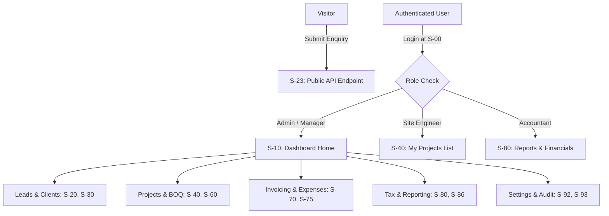
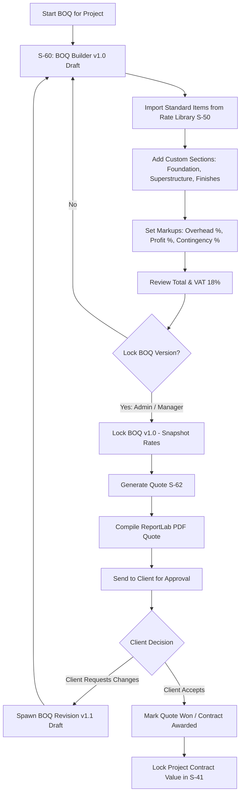
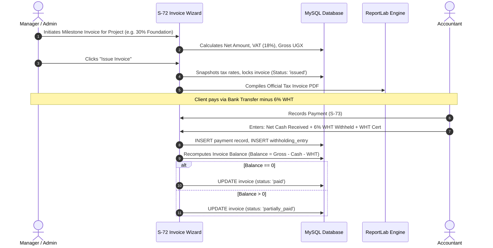
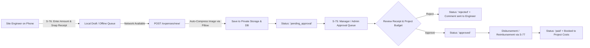

# Jimcan Operations Dashboard: User Journeys & Operational Flows

**Document:** `docs/design/flows.md`  
**Version:** 0.1  
**Date:** 24 October 2026  
**Status:** Draft for review  
**Owner:** George  
**Related Documents:**
- [`../../Project_Plan/Jimcan Operations Dashboard App Flow Document.md`](file:///home/george/Desktop/Dev2026/Jimcan/Project_Plan/Jimcan%20Operations%20Dashboard%20App%20Flow%20Document.md)
- [`screens.md`](file:///home/george/Desktop/Dev2026/Jimcan/docs/design/screens.md)
- [`roles-permissions.md`](file:///home/george/Desktop/Dev2026/Jimcan/docs/design/roles-permissions.md)
- [`states.md`](file:///home/george/Desktop/Dev2026/Jimcan/docs/design/states.md)
- [`data-contracts.md`](file:///home/george/Desktop/Dev2026/Jimcan/docs/design/data-contracts.md)

---

## 1. Global Navigation & System State Flow

### 1.1 Navigation Architecture
Users navigate through role-specific routes. Permissions are strictly enforced server-side by Django view mixins. Client-side navigation hides unauthorized links.



### 1.2 Session Expiry & CSRF Recovery Flow
1. **Idle Detection:** If user is inactive for 59 minutes, an Alpine.js modal warns: *"Your session will expire in 60 seconds due to inactivity."*
2. **Auto-Lock:** At 60 minutes, session terminates. Unsaved form content in DOM is serialized to `sessionStorage`.
3. **Re-Authentication Modal:** User enters password in lightweight modal without leaving page. On success, fresh CSRF token is injected and form submission proceeds.
4. **Hard Timeout:** If modal is dismissed, redirect to `S-00` with `?next=/target-url/`.

---

## 2. Inbound Lead to Client & Project Flow

```mermaid
sequenceDiagram
    autonumber
    actor V as Prospect / Visitor
    participant W as Public Website
    participant D as Django (S-23 / S-20)
    actor M as Manager / Admin
    participant DB as MySQL DB
    
    V->>W: Submits contact form on jimcanconstruction.site
    W->>D: POST /public/leads/ (Name, Phone, Project Type, Details)
    D->>DB: INSERT into leads (status: 'new', is_deleted: false)
    D-->>M: Outbox email alert: "New Lead Received"
    M->>D: Views Lead Pipeline (S-20)
    M->>D: Contacts lead, updates status to 'contacted' -> 'site_visit'
    M->>D: Clicks "Convert to Client" (S-21)
    D->>DB: INSERT into clients; UPDATE leads (status: 'won')
    D->>DB: INSERT into projects (phase: 'brief', lead_id)
    D-->>M: Redirects to Project Workspace (S-41)
```

### Edge & Failure Paths:
- **Duplicate Detection:** If phone/email matches an existing client, system displays alert: *"Existing Client Found: John Doe. Link lead to existing client?"*
- **Spam Submission:** Submissions failing the honeypot or IP rate limit (max 5 per hour per IP) return HTTP 429 and are dropped without database insertion.

---

## 3. Rate Library, BOQ Builder & Quotation Flow



### Immutability & Safety Rules:
- Once a BOQ is locked (`BOQVersion.is_locked = True`), item quantities and rates are frozen.
- Any modification creates `BOQVersion` `v1.1` with a required change reason string.

---

## 4. Contract Execution, Progress Invoicing & Withholding Flow



### Exception & Voiding Path:
- **Voiding an Issued Invoice:** Only `Admin` can void. Requires non-empty `void_reason`. Voiding creates an offsetting reversal entry, restores milestone status, and writes to `audit_logs`. Hard deletion is strictly forbidden.

---

## 5. Site Expense Logging & Approval Flow



---

## 6. Site Progress Photos & Offline Synchronization Flow

1. **Capture:** Site Engineer opens `S-47` on mobile browser.
2. **Network Detection:** Alpine.js monitors `navigator.onLine`.
   - If **Online:** Direct upload to Django endpoint with upload progress bar.
   - If **Offline:** Photo is converted to blob and saved into browser `IndexedDB` with metadata (project ID, timestamp, phase). Badge updates: *"1 Photo Queued Offline"*.
3. **Background Sync:** When browser detects online event, Alpine dispatches sequential queue worker:
   - Posts blob via `fetch()` to `/files/upload/`.
   - Django compresses image via Pillow (strips EXIF, resizes to max 2000px, quality 85%).
   - On HTTP 200, item is purged from `IndexedDB`.
   - If failure occurs, retry counter increments up to 5 times before flagging manual intervention on `S-90`.

---

## 7. Monthly Tax Closing Flow

1. **Trigger:** On the 1st of each month, system creates `TaxPeriod` (e.g. `2026-10`).
2. **Review:** Accountant opens `S-86` (Tax Hub).
3. **Reconciliation:**
   - Review Sales Output VAT (`S-87`).
   - Review Eligible Purchase Input VAT.
   - Review WHT credits received from clients vs WHT deducted from subcontractors (`S-88`).
4. **Filing Verification:** Accountant enters official URA payment registration number (PRN) and marks period `filed`.
5. **Closure:** Period is locked. No historical invoices or expenses can be back-dated into a closed period without Admin override.

---

## 8. Open Questions Relevant to Flows
1. `[OQ-05]`: Whether client acceptance of quotes requires a digital signature pad in S-62 or a simple status toggle by the Manager.
2. `[OQ-06]`: Maximum offline queue capacity on mobile devices before warning user of device storage limits.

---

## 9. Change Log
- **24 October 2026 (v0.1):** End-to-end operational flows documented covering all 10 core system processes.

*Unresolved items must not be treated as approved requirements.*
